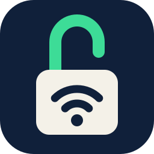

# uncaptive

Logs in to known Wi-Fi captive portals without a browser.  Meant to be
run by NetworkManager when it detects a portal, so train and café
Wi-Fi just works.

Supported portals:

| Handler   | Portal hosts                              | Seen on                          |
|-----------|-------------------------------------------|----------------------------------|
| `icomera` | `*.on.icomera.com`, `www.ombord.info`      | Tåg i Bergslagen (newer trains)  |
| `oxyfi`   | `*.internet--access.net`                   | Tåg i Bergslagen (older trains)  |

## How it works

1. Fetch a connectivity-check URL without following redirects.  A
   portal answers with a redirect to itself.
2. Pick a handler from the portal's hostname.
3. Replay what the portal's own JavaScript does when you press
   Connect/Continue:
   - Icomera: one `GET /hotspot/hotspot.cgi?method=login&url=…&onerror=…`
     on `www.ombord.info`, then poll `/api/jsonp/user/` until
     `authenticated` is `1`.  Captured from a real login (HAR).
   - Oxyfi: the JSONP state machine in `oxyfiLogin.js`: node command
     400201 (device data), backend `initiate`, `acceptTerms`,
     `setupRequest`, then the backend-queued node command 400005
     (login).  Reconstructed from the portal's published JavaScript;
     not yet verified on a train.
4. With `--recheck`, ask NetworkManager to re-run its connectivity
   check so the desktop drops its "sign in" prompt.

## Install

    sudo make install

This puts `uncaptive` in `/usr/local/bin` and the dispatcher
hook in `/etc/NetworkManager/dispatcher.d/no-wait.d/`, linked from
`dispatcher.d/` so NetworkManager runs it without waiting.  The hook
fires on `connectivity-change` with `CONNECTIVITY_STATE=PORTAL` and logs
to syslog under `uncaptive`:

    journalctl -t uncaptive

## Run by hand

    uncaptive -v                 # probe, detect, log in
    uncaptive -v --portal 'https://tib.internet--access.net/'

Exit status: 0 logged in or no portal, 1 login failed, 2 unknown portal.

## Test

    make check

`test/fake-portal.py` emulates both portals on localhost and runs the
tool against them.

## Adding a portal

Capture the login with the browser's network inspector (save as HAR),
find the request the Connect button sends, write a `name(portal, base)`
function that replays it and returns True on success, and add it to
`HANDLERS` with a hostname regex.

## License

ISC, see [LICENSE](LICENSE).
